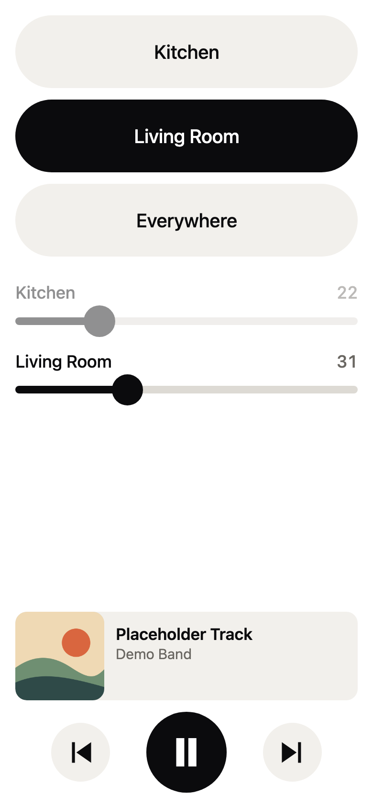
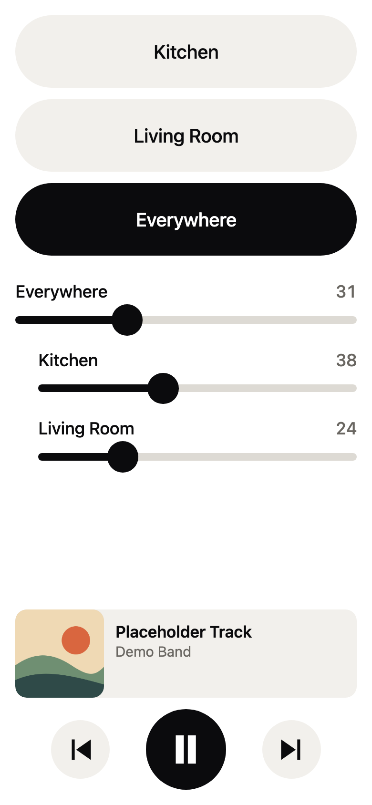

# Rooms for Sonos

A small web page, served from your home router, that moves Sonos music between two rooms or plays it in both. Each room has a volume slider, and when both rooms are playing a third slider changes them together and keeps the balance between them.

It runs on GL.iNet and DD-WRT routers and talks to the speakers directly over your home network. There is no account, cloud service or app to install.

<p>
  
  
</p>

The album art and track in these pictures are placeholders.

## Why it exists

Spotify lists Sonos speakers one room at a time. To play in two rooms, you open the Sonos app, wait for it to find the system, and group them there. Rooms turns that into one tap on your Home Screen, and the music keeps playing while it moves.

Rooms doesn't add an "Everywhere" device to Spotify's list. That would need an unofficial Spotify Connect receiver, and Spotify currently refuses those the keys they need to play audio ([librespot#1649](https://github.com/librespot-org/librespot/issues/1649), [SpotConnect#90](https://github.com/philippe44/SpotConnect/issues/90)). Once Rooms has grouped the speakers, Spotify shows the group as "Kitchen + 1", and you can keep using Spotify as usual.

## What you can do with it

- Move the music to either room, or play it in both.
- Set each room's volume, including a room that isn't playing, so it's ready when you switch.
- Change both rooms at once without changing their balance.
- See the album art, title and artist. Tap them to open Spotify.
- Play, pause, and skip forward or back.

The page updates once a second, so changes made in Spotify or the Sonos app appear by themselves. Room names come from your Sonos system, so renaming a room there renames it here.

On an iPhone it can live on the Home Screen, where it opens quickly and shows a short message if you're away from home.

## Install

You need a router on the same network as your speakers, and a computer with `ssh` and `git`.

| Router | Guide | Tested on |
| --- | --- | --- |
| GL.iNet | [How to install Rooms on a GL.iNet router](docs/setup-gl-inet.md) | GL-AXT1800, firmware 4.8.3, real speakers |
| DD-WRT | [How to install Rooms on a DD-WRT router](docs/setup-dd-wrt.md) | Not yet tried on a physical router; see the guide |

On a GL.iNet router with its default address, the install looks like this:

```bash
git clone https://github.com/mohsen1/rooms-for-sonos.git
cd rooms-for-sonos
./install.sh gl-inet root@192.168.8.1
```

Then open `http://192.168.8.1:8081/` on your phone.

## How it works

Sonos speakers accept UPnP commands from anything on the local network, on port 1400. The router is always on and already on that network, so it's a good place to send them from.

```text
phone  --HTTP-->  router  --UPnP, port 1400-->  speakers
```

- [`app/www/index.html`](app/www/index.html) is the whole page. It's a single file with no dependencies, and it asks the router for the current state once a second.
- [`app/www/cgi-bin/rooms`](app/www/cgi-bin/rooms) is a CGI script that answers those requests and carries out changes.
- [`app/sonos.sh`](app/sonos.sh) sends the commands to the speakers with `curl` and reads the replies with `sed`.

Two Sonos behaviours do most of the work. To move music without stopping it, Rooms groups the two rooms, hands the group to the new room with `DelegateGroupCoordinationTo`, and then releases the old room. To keep the balance, it takes one `SnapshotGroupVolume` at the start of a drag and then sends `SetGroupVolume`, and Sonos scales each room from that snapshot.

Two parts of getting a plain HTTP page to work on a current iPhone have their own notes:

- [Opening a Home Screen web app with no network and no HTTPS](docs/ios-home-screen-offline.md)
- [Why Safari hangs on some plain HTTP servers](docs/safari-https-first.md)

## Limits

- **Two rooms.** If you have more, the installer asks which two to use. The page has only been designed and tested for two.
- **No login.** Anyone on your network can control the speakers. Rooms refuses requests sent by other websites, but don't forward its port to the internet.
- **Unofficial.** Rooms uses the same local interface as many other Sonos tools, but Sonos could change it.
- **Spotify only, so far.** Grouping and volume don't depend on the music source, but no other service has been tried.

## Tests

The tests run without a router or speakers. [`test/fake_sonos.py`](test/fake_sonos.py) pretends to be a small Sonos household, including a surround speaker and a stereo pair.

To test the page and scripts on BusyBox and lighttpd:

```bash
docker run --rm -v "$PWD:/src:ro" alpine:3.22 sh /src/test/run.sh
```

To install real Entware and run the DD-WRT install, a simulated reboot and removal:

```bash
docker run --rm -v "$PWD:/src:ro" alpine:3.22 sh /src/test/entware.sh
```

## Licence

[MIT](LICENSE).

Rooms is an independent project. It isn't affiliated with or endorsed by Sonos, Spotify, GL.iNet or DD-WRT.
